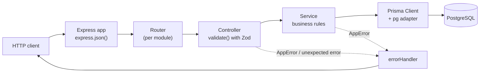
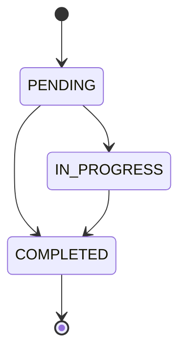
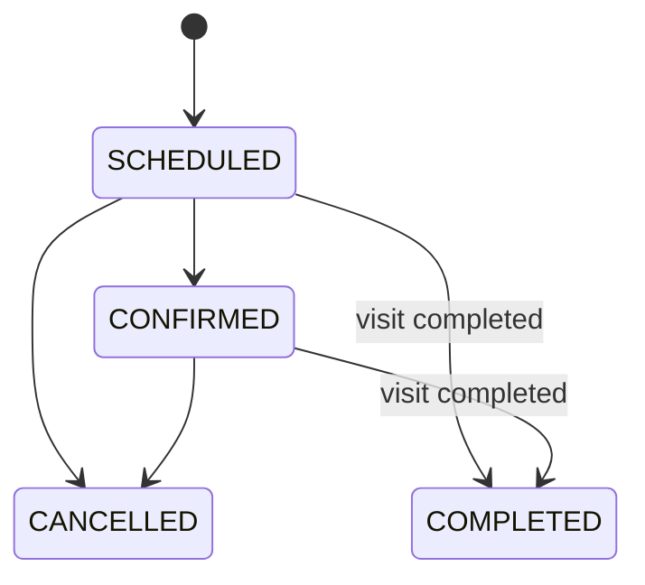

# Architecture

A layered, feature-module REST API: **Express 5 → Zod validation → service layer → Prisma → PostgreSQL**.

## Layers

| Layer | Responsibility | Location |
|---|---|---|
| App bootstrap | Creates the Express app, mounts routers, health checks, the global error handler | `src/app.ts`, `src/index.ts` |
| Router | Maps HTTP verb + path to a controller function | `src/modules/*/*.routes.ts` |
| Controller | Validates `params`, `query` and `body` with Zod; calls the service; picks the status code | `src/modules/*/*.controller.ts` |
| Validation | Zod schemas and inferred input types | `src/modules/*/*.validation.ts`, `src/utils/schemas.ts`, `src/utils/validate.ts` |
| Service | Business rules, cross-entity checks, transactions, Prisma queries | `src/modules/*/*.service.ts` |
| Data access | Prisma client with the `@prisma/adapter-pg` adapter; reads `DATABASE_URL` | `src/lib/prisma.ts` |
| Config | `CLINIC_TIMEZONE` (default `Africa/Cairo`, validated at startup) | `src/config/clinic.ts` |
| Errors | `AppError` class and global `errorHandler` | `src/utils/app-error.ts`, `src/modules/patients/error.middleware.ts` |

Each module follows the same shape: `routes → controller → service`, with its own `validation.ts`. Pure rules that are easy to unit test are extracted (for example `dental-visits.rules.ts`, `appointment-status.ts`, `plan-item-status.ts`).

## Request lifecycle

Example: `POST /appointments`.

1. `express.json()` parses the body. Malformed JSON is turned into `400 { "message": "Invalid JSON body" }` by the error handler.
2. The `/appointments` router dispatches to `appointments.controller.create`.
3. The controller calls `validate(createAppointmentSchema, req.body)`. On failure it throws `AppError(400, 'Validation failed', [{ field, message }])`.
4. `createAppointment` in the service:
   1. rejects a start time that is not in the future,
   2. loads the patient, dentist and service in one `$transaction` and checks that each exists and is active and that the dentist offers the service,
   3. computes `endAt` from the service's `durationMin` (or the optional `durationMin` override),
   4. checks for a conflicting `SCHEDULED`/`CONFIRMED` appointment for that dentist,
   5. inserts the row; a PostgreSQL exclusion-constraint violation (a concurrent double booking) is translated to `409`.
5. The controller responds `201` with the appointment (including `patient`, `dentist`, `service` summaries).
6. Any thrown `AppError` is serialised as `{ "message": ..., "details": ... }` with its status code; anything else is logged and returned as `500 { "message": "Internal server error" }`. Express 5 forwards rejected promises from async handlers to the error handler, so controllers contain no `try/catch`.

## Error handling

| Case | Status | Body |
|---|---|---|
| Zod validation failure | `400` | `{ "message": "Validation failed", "details": [{ "field", "message" }] }` |
| Malformed JSON | `400` | `{ "message": "Invalid JSON body" }` |
| Referenced entity does not exist (in a body) | `400` | `{ "message": ..., "details"? }` |
| Resource not found | `404` | `{ "message": "<Entity> not found" }` |
| Uniqueness, state or business-rule conflict | `409` | `{ "message": ..., "details"? }` |
| Unexpected error | `500` | `{ "message": "Internal server error" }` |

Requests to a path that no router handles fall through to Express's default 404 response (there is no custom catch-all).

## Concurrency and data integrity

The service layer is written to stay correct under concurrent requests:

- **Double-booking prevention in two layers.** `assertDentistFree` gives a friendly `409` with the conflicting appointment; the PostgreSQL `EXCLUDE USING gist` constraint is the authoritative guard and its violation is mapped to the same `409`.
- **Compare-and-set updates.** State changes use conditional writes such as `update({ where: { id, status: current } })` / `updateMany({ where: { id, status } })`. If another request changed the row first, the update matches nothing and the API answers `409` ("…changed by another request, reload and try again") instead of overwriting.
- **Transactions for multi-step flows.**
  - Starting a visit locks and validates the appointment, then creates the visit.
  - Recording a procedure creates the `PerformedProcedure` and marks the linked plan item `COMPLETED` atomically.
  - Completing a visit marks the visit `COMPLETED` and its appointment `COMPLETED` atomically.
- **Uniqueness races** (`P2002`) are caught and mapped to `409`; missing rows (`P2025`) to `404` or `409` as appropriate.
- **Price snapshot.** A plan item copies the service price at creation, so later price changes do not rewrite existing plans.

## Business rules by module

**Patients** – unique `fileNumber` and `phone` (Egyptian mobile format `01[0125]xxxxxxxx`); date of birth cannot be in the future; deactivation instead of deletion.

**Dentists / Dental Services** – unique names/phones; `PUT /dentists/:id/services` replaces the set of services a dentist offers (only existing, active services can be added).

**Treatment Plans** – a plan can only be created or extended for an active patient; every item needs an active service, an active dentist, and a dentist who offers that service. Item status flow:

Completed items cannot be edited; only `PENDING` items can be deleted. Plan responses include a computed `summary` (`totalItems`, `completedItems`, `remainingItems`).

**Appointments** – must start in the future; duration defaults to the service's `durationMin`; no overlap for the same dentist; only `SCHEDULED`/`CONFIRMED` appointments can be edited. Manual status flow:

`COMPLETED` is reached only by completing the related dental visit, not through `PATCH /appointments/:id/status`.

**Dental Visits** – a visit can start only from a `SCHEDULED`/`CONFIRMED` appointment, once per appointment. Procedures and notes can only change while the visit is `ACTIVE`. A procedure linked to a plan item must match the visit's patient and dentist and the item's service.

## Testing

`npm test` runs `src/modules/dental-visits/dental-visits.rules.test.ts` with Node's built-in test runner (`node --test`) through `tsx`. It contains 12 tests covering the visit rules, request schemas, the start / record-procedure / complete flows and transaction rollback, using an in-memory fake of the Prisma client, so the tests never query a database. They still import the service modules, which load `src/lib/prisma.ts`, so `DATABASE_URL` must be set (any well-formed value; see `.env.example`) and the Prisma client must have been generated with `npm run db:generate`.
