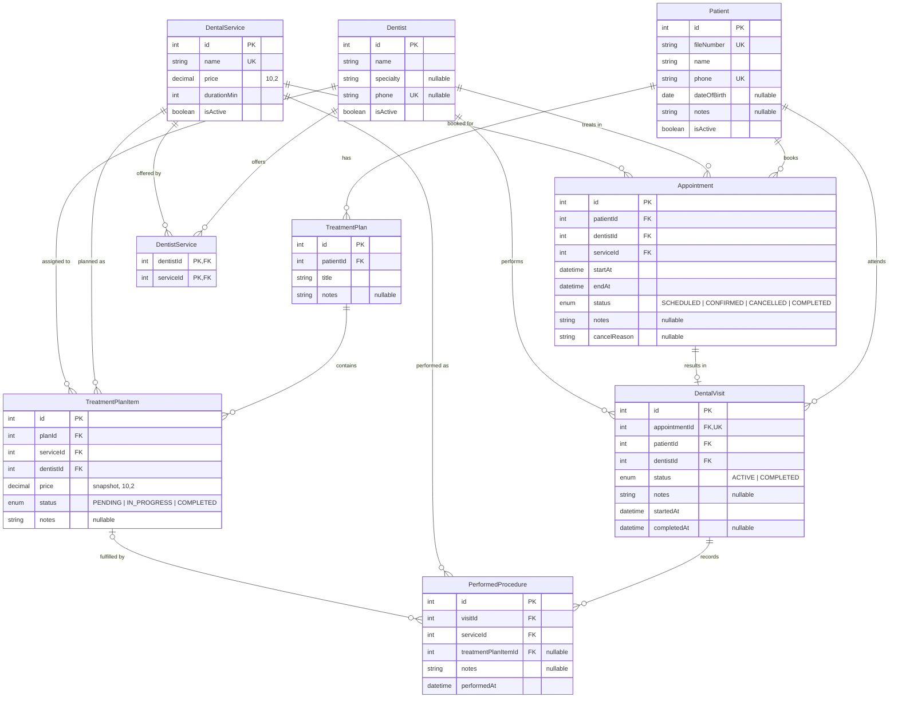

# Database

PostgreSQL, modelled with Prisma (`prisma/schema.prisma`) and evolved through SQL migrations in `prisma/migrations/`. The Prisma client is generated into `generated/` (git-ignored) and used through the `@prisma/adapter-pg` driver adapter (`src/lib/prisma.ts`).

## Entity relationship diagram



Every table except the `DentistService` join table also carries `createdAt`, and every table except `DentistService` and `PerformedProcedure` carries an auto-updated `updatedAt`. These are omitted from the diagram for readability.

## Entities

| Entity | Purpose |
|---|---|
| **Patient** | A clinic patient. Identified externally by a unique `fileNumber` and a unique Egyptian mobile `phone`. Deactivated (`isActive = false`) rather than deleted. |
| **Dentist** | A clinic dentist with an optional `specialty` and optional unique `phone`. Activated/deactivated via `isActive`. |
| **DentalService** | A catalogue entry (name, price, default duration in minutes). Names are unique; `isActive` controls whether it can be used for new bookings and plans. |
| **DentistService** | Join table: which dentists offer which services (composite primary key). |
| **TreatmentPlan** | A titled care plan for one patient. It has no status of its own; progress is derived from its items. |
| **TreatmentPlanItem** | One planned service for one dentist inside a plan, with a **price snapshot** copied from the service when the item is created, and a status. |
| **Appointment** | A booking of a patient with a dentist for a service over `[startAt, endAt)`. |
| **DentalVisit** | The actual visit that happens for an appointment (one-to-one). `ACTIVE` while in progress, `COMPLETED` when finished. |
| **PerformedProcedure** | A service that was actually performed during a visit; optionally linked to the plan item it fulfils. |

## Relationships and rules

- **Patient 1 — N TreatmentPlan, Appointment, DentalVisit.**
- **Dentist N — M DentalService** through `DentistService`.
- **TreatmentPlan 1 — N TreatmentPlanItem.** Each item references one service and one dentist.
- **Appointment 1 — 0..1 DentalVisit** (`DentalVisit.appointmentId` is unique).
- **DentalVisit 1 — N PerformedProcedure.** A procedure may reference a `TreatmentPlanItem`; the pair `(visitId, treatmentPlanItemId)` is unique, so a plan item can only be recorded once per visit.
- Records are not hard-deleted through the API, with one exception: a plan item that is still `PENDING` can be deleted. Patients, dentists and services are deactivated via `isActive`.

## Database-level safeguards

Defined in migration `20261109233635_appointments`:

```sql
CREATE EXTENSION IF NOT EXISTS btree_gist;

ALTER TABLE "Appointment"
  ADD CONSTRAINT "Appointment_end_after_start" CHECK ("endAt" > "startAt");

ALTER TABLE "Appointment"
  ADD CONSTRAINT "Appointment_dentist_no_overlap"
  EXCLUDE USING gist (
    "dentistId" WITH =,
    tsrange("startAt", "endAt") WITH &&
  )
  WHERE ("status" IN ('SCHEDULED', 'CONFIRMED'));
```

This guarantees, at the database level, that one dentist can never have two overlapping active appointments, even under concurrent requests. Cancelled and completed appointments do not block a slot. The application also checks for conflicts first so it can return a descriptive `409` (see [architecture](architecture.md#concurrency-and-data-integrity)).

## Indexes

| Table | Index |
|---|---|
| Patient | `name` |
| Dentist | `name` |
| DentistService | `serviceId` |
| TreatmentPlan | `patientId` |
| TreatmentPlanItem | `planId`, `dentistId`, `serviceId` |
| Appointment | `startAt`, `(dentistId, startAt)`, `(patientId, startAt)` |
| DentalVisit | `(patientId, startedAt)`, `(dentistId, startedAt)`, `(status, startedAt)` |
| PerformedProcedure | `serviceId` |

## Enums

| Enum | Values |
|---|---|
| `PlanItemStatus` | `PENDING`, `IN_PROGRESS`, `COMPLETED` |
| `AppointmentStatus` | `SCHEDULED`, `CONFIRMED`, `CANCELLED`, `COMPLETED` |
| `DentalVisitStatus` | `ACTIVE`, `COMPLETED` |

## Migrations

Eight migrations under `prisma/migrations/`, from the initial patients table (`init`) through dentists and services, treatment plans, appointments (including the constraints above) and dental visits.
